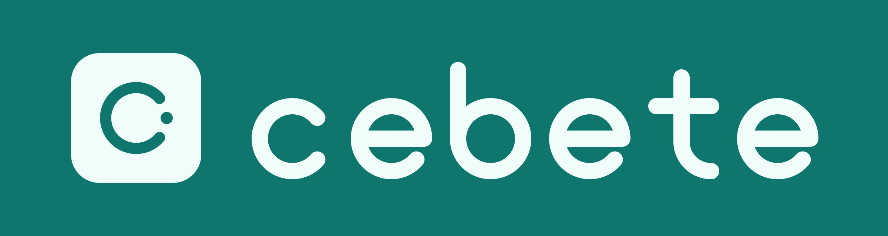

cebete is a private tracker for cognitive behavioural therapy (CBT) practice. It runs in your browser, works offline, and can be installed on a phone like an app.

## What it does

- **Mood log:** record how you feel, with emotions rated from 0 to 10, and look back over time.
- **Thought records:** write down a difficult thought, then challenge it and test it, and see how your belief changes.
- **Coping library:** keep your own calming techniques and reminders, and reach them quickly from a "Need to settle?" screen.
- **Home summary:** a short look at your last week or month, such as your most frequent emotions and how your beliefs have changed.
- **Backup:** save a copy of everything to a file, and restore it later.

## Your privacy

Everything you record stays in your browser, on your device. cebete sends nothing to any server and has no analytics. Backup files are plain text, so keep them somewhere safe.

The browser keeps the data for one exact web address. The same app at a different address starts empty, so export a backup first if you ever move it.

## A note on care

cebete is a self-help tool. It is not medical advice, and it is not a substitute for professional care or emergency help.

## Running it

You need Node.js 22.12 or newer.

```sh
npm install
npm run dev
```

Other commands:

- `npm run build` makes the production build, and `npm run preview` serves it.
- `npm run typecheck`, `npm run format`, `npm run lint`, `npm run build` and `npm test` are the five checks, run in that order.

## Licence

MIT. See the [LICENSE](LICENSE) file.
