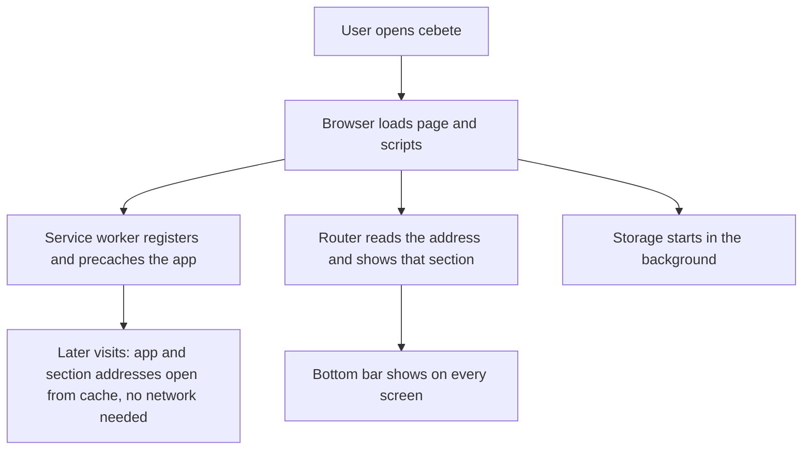

## Summary

The app shell is the frame of cebete: a React single-page app, built with Vite, with a calm teal look and a bottom navigation bar between its sections. It installs as a PWA, opens offline, and carries its own identity (name and icon). It also owns the project's quality tooling. It does not cover the content of the CBT features (see [mood-log](../mood-log/spec.md) and [backup](../backup/spec.md)) or the local database (see [storage](../storage/spec.md)).

## How it works

- **Sections and addresses:** Home (`/`), Mood (`/mood`) and Settings (`/settings`). The current section is part of the address, so a reload or the browser's back and forward buttons keep the user in place. Any unknown address goes to Home.
- **Screens:** Home shows the "cebete" heading and a short welcome. Mood hosts the mood log (see [mood-log](../mood-log/spec.md)). Settings shows a Backup section for saving and restoring the user's data (see [backup](../backup/spec.md)).
- **Bottom bar:** fixed at the bottom of every screen, with an icon and a label per section. The current section is highlighted and marked as current for assistive technology. The bar is a navigation landmark named "Main". It holds at most five items, so a new module must earn a place or live inside an existing section.
- **Look:** built with Chakra UI. The main colour is a calm teal that matches the icon, on faint teal-tinted neutral surfaces with soft dark text. The app is light only. The theme is defined in one place, so the palette is set once.
- **Install:** the manifest names the app "cebete", opens it standalone from `/`, uses the brand teal as its theme colour, and declares the standard, 512 and maskable icons. A supporting browser offers installation.
- **Offline:** after the first visit the service worker serves the whole app, including every section address, from its cache. New versions install quietly in the background and take over on the next visit.
- **Storage startup:** runs next to rendering and never blocks it (see [storage](../storage/spec.md)).
- **Identity:** the icon is a teal tile with an open "c" ring and a small dot. A one-time script draws it as SVG and renders the PNG sizes; it is a development tool and is not part of the running app.

## Data and files

| Concern     | Choice                                                                                                   |
| ----------- | -------------------------------------------------------------------------------------------------------- |
| UI          | React 19, strict TypeScript                                                                              |
| Styling     | Chakra UI 3 with Emotion, themed centrally                                                               |
| Routing     | React Router, with normal (non-hash) addresses                                                           |
| Icons       | `react-icons` (Lucide set)                                                                               |
| Data views  | `dexie-react-hooks`, so lists update by themselves when the stored data changes                          |
| Build       | Vite, with a PWA plugin using a generated service worker and a precache of the app files and icons       |
| Tests       | Vitest with Testing Library and jsdom; a fake IndexedDB for database tests                               |
| Quality     | Prettier (no semicolons, single quotes, 100 columns), ESLint 9 with type-checked TypeScript, React hooks and accessibility rules |
| Icon script | Draws the SVG master and renders PNGs with `sharp` (dev dependency only)                                 |

| Where                         | What                                                             |
| ----------------------------- | ---------------------------------------------------------------- |
| `src/main.tsx`                | Entry point: wires the theme, the router and storage startup     |
| `src/App.tsx`                 | Page frame: the routes, the bottom bar, and room for the bar     |
| `src/screens/`                | The Home, Mood and Settings screens                              |
| `src/mood/`                   | The mood log feature: its rules, storage access and components   |
| `src/backup/`                 | The backup feature: file rules and the Backup section            |
| `src/navigation/`             | Section addresses, the bar's items, the bar itself, bar sizing   |
| `src/theme/`                  | The colour palettes and the theme definition                     |
| `pwa.config.ts`               | Manifest and service worker settings, tested directly            |
| `vite.config.ts`              | Vite and Vitest configuration, including the `@` and `@tests` aliases |
| `index.html`                  | Page title, viewport, light colour scheme, favicon and Apple touch icon links |
| `public/`                     | Generated icons (SVG master, favicon, Apple touch, PWA PNGs)     |
| `scripts/generate-icons.js`   | One-time icon generator, rerun with `npm run icons`              |
| `tests/`                      | All tests, the shared setup and helpers, mirroring the layout of `src/` |
| `tsconfig.test.json`          | Type-check project for `tests/`, same strictness as the app      |

The five checks are the npm scripts `typecheck`, `format`, `lint`, `build` and `test`, run in that order.

## Rules and edge cases

- **Calm colours:** warnings and errors use muted tones, never a vivid red, and the default palettes for grey, red and orange are replaced to guarantee it. Text and background pairs that matter (body, muted, button, active bar item, error, warning) must meet a readable contrast ratio of 4.5:1; tests enforce both.
- **Light only:** the page declares a light colour scheme, so the browser's dark preference does not change the look. Dark mode is not supported.
- **Bar and phones:** tap targets are at least 56 px tall, the bar stays clear of a notch or home indicator, and the page reserves room at the bottom so the bar never covers content. The Home address only counts as current on Home itself.
- **Clean addresses need host support:** reloading on `/mood` works offline through the service worker and in the preview server, but a plain static host must send every address to `index.html`.
- **Bundle size:** the app ships as a single script of roughly 600 kB (about 180 kB compressed), mostly Chakra UI. The build prints a chunk-size warning, which is not suppressed.
- Every icon in the manifest must be a real PNG of the declared size; a test enforces this.
- All tests live under `tests/`, mirroring `src/` (for example `tests/db/` for the database), never beside the source files. Nothing test-related belongs in `src/`.
- Imports that cross folders use the `@` alias for `src/`; a relative import is for a file in the same folder. Tests also have a `@tests` alias for shared helpers. Both aliases are defined in the TypeScript config and the Vite config, which the test runner reuses, and the two must stay in sync.
- The PWA settings test runs in a Node environment. It imports the root PWA config relatively, the single exception to the alias rule, because that file sits outside `src/`.
- ESLint is pinned to version 9 because the accessibility plugin does not yet support version 10. Its object-type rule is set to prefer `type`, to follow the project's code conventions.
- `docs/` and `.claude/` are excluded from linting and formatting.
- `npm audit` reports moderate findings in build-time tooling pulled in by the PWA plugin. They do not ship in the app, and the available fix is a breaking downgrade, so it is not applied.
- On the development machine (Windows), run the checks from PowerShell. From Git Bash, Vitest fails on every test because of a drive-letter casing mismatch in the path.
- Layout, installability and offline behaviour cannot be proven by unit tests. They were verified against a production preview in a real browser, on a phone-sized and a desktop-sized window.

## Related

- [storage](../storage/spec.md): the local database opened at startup.
- [mood-log](../mood-log/spec.md): the feature shown in the Mood section.
- [backup](../backup/spec.md): the feature shown in the Settings section.
