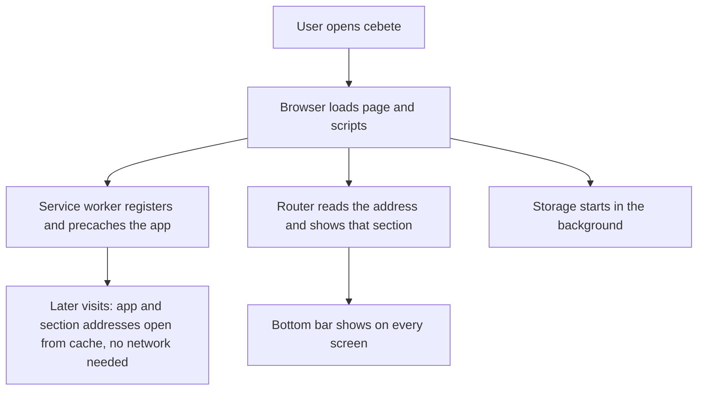

## Summary

The app shell is the frame of cebete: a React single-page app, built with Vite, with a calm teal look and a bottom navigation bar between its sections. It installs as a PWA, opens offline, and carries its own identity (name and icon). It does not cover the content of the CBT features (see [mood-log](../mood-log/spec.md), [thoughts](../thoughts/spec.md), [coping](../coping/spec.md) and [backup](../backup/spec.md)) or the local database (see [storage](../storage/spec.md)).

## How it works

- **Sections and addresses:** Home (`/`), Mood (`/mood`), Thoughts (`/thoughts`, with one record at `/thoughts/:id`) and Settings (`/settings`). The section is part of the address, so a reload or the browser's back and forward buttons keep the user in place. The coping library (`/coping`) and the quick "Need to settle?" screen (`/settle`) have no bar item. The settle screen is entered from Home, and the library only from the settle screen. Unknown addresses go to Home. Home shows the "cebete" heading, a short welcome, a calm "Need to settle?" card (always first), two quick actions, "Log how I feel" and "Write down a thought", a gentle backup reminder when one is due (see [backup](../backup/spec.md)), and a short summary of the last week or month (see [insights](../insights/spec.md)); the other screens host their features.
- **Quick actions:** each opens its section with the entry form already open: Mood with the new-entry form (see [mood-log](../mood-log/spec.md)), Thoughts with the guided capture (see [thoughts](../thoughts/spec.md)). The request travels in the navigation history entry, is read once when the section appears, and is then cleared by replacing the entry, so one tap of Back returns to Home and a reload does not reopen the form. A section opened from the bottom bar or by its address never shows a form, and the form opens even while the list is loading or cannot be loaded.
- **Bottom bar:** fixed on every screen, with an icon and a label per section. The current section is highlighted and marked as current, also on an address below it such as one thought record. Home is also current on the coping library and the settle screen, which it hosts. It is a navigation landmark named "Main" and holds at most five items (four used), so a new module must earn a place or live inside a section.
- **Look:** Chakra UI with a calm teal main colour on faint teal-tinted surfaces and soft dark text. Light only. The theme is defined in one place.
- **Install:** the manifest names the app "cebete", opens it standalone from `/`, uses the brand teal as theme colour, and declares the standard, 512 and maskable icons.
- **Offline:** after the first visit the service worker serves the whole app, including every section and record address, from its cache. New versions install quietly and take over on the next visit.
- **Storage startup:** runs next to rendering and never blocks it (see [storage](../storage/spec.md)).
- **Identity:** a teal tile with an open "c" ring and a small dot, drawn by a one-time development script that is not part of the running app.

## Data and files

| Concern    | Choice                                                                                  |
| ---------- | --------------------------------------------------------------------------------------- |
| UI         | React 19, strict TypeScript                                                             |
| Styling    | Chakra UI 3 with Emotion, themed centrally                                              |
| Routing    | React Router, normal (non-hash) addresses                                               |
| Icons      | `react-icons` (Lucide set)                                                              |
| Data views | `dexie-react-hooks`, so lists update when stored data changes                           |
| Build      | Vite, with a PWA plugin (generated service worker, precache of app files and icons)     |
| Tests      | Vitest with Testing Library and jsdom; a fake IndexedDB for database tests              |
| Quality    | Prettier, and ESLint 9 with type-checked TypeScript, React hooks and accessibility rules |
| Icons tool | Script that draws the SVG master and renders PNGs with `sharp` (dev only)               |

| Where                       | What                                                                 |
| --------------------------- | -------------------------------------------------------------------- |
| `src/main.tsx`, `src/App.tsx` | Entry point (theme, router, storage startup) and the page frame with the routes and bar |
| `src/screens/`              | The Home, Mood, Thoughts, thought record, coping library, settle and Settings screens |
| `src/mood/`, `src/thoughts/`, `src/coping/`, `src/backup/`, `src/insights/` | The feature modules |
| `src/shared/`               | Controls used by more than one feature module                        |
| `src/navigation/`           | Addresses, the bar's items, the rule for the current item, the open-form request, the bar and its sizing |
| `src/theme/`                | The palettes and the theme definition                                |
| `pwa.config.ts`, `vite.config.ts` | Manifest and service worker settings; Vite and Vitest configuration |
| `public/`, `scripts/`       | Generated icons and the icon generator (`npm run icons`)             |
| `tests/`                    | All tests, mirroring `src/`                                          |

The five checks are the npm scripts `typecheck`, `format`, `lint`, `build` and `test`, run in that order (see the project's code conventions in `.claude/rules/`).

## Rules and edge cases

- **Calm colours:** warnings and errors use muted tones, never a vivid red. Key text and background pairs must meet a 4.5:1 contrast ratio; tests enforce it.
- **Light only:** the page declares a light colour scheme, so the browser's dark preference changes nothing.
- **Bar and phones:** tap targets are at least 56 px tall, the bar stays clear of a notch or home indicator, and the page reserves room so the bar never covers content. Home is current only on Home itself and on the addresses it hosts, never on another section.
- **Clean addresses need host support:** reloading on `/mood` or `/thoughts/7` works offline through the service worker and in the preview server, but a plain static host must send every address to `index.html`.
- **Bundle size:** a single script of roughly 600 kB (about 180 kB compressed), mostly Chakra UI. The build's chunk-size warning is not suppressed.
- Every icon in the manifest must be a real PNG of the declared size; a test enforces this.
- ESLint is pinned to version 9 because the accessibility plugin does not yet support version 10.
- `npm audit` reports moderate findings in build-time tooling of the PWA plugin. They do not ship, and the fix is a breaking downgrade, so it is not applied.
- Layout, installability and offline behaviour cannot be proven by unit tests; they are checked against a production preview in a real browser.

## Related

- [storage](../storage/spec.md): the local database opened at startup.
- [mood-log](../mood-log/spec.md): the feature shown in the Mood section.
- [thoughts](../thoughts/spec.md): the feature shown in the Thoughts section.
- [coping](../coping/spec.md): the feature entered from Home through the settle screen.
- [backup](../backup/spec.md): the feature shown in the Settings section.
- [insights](../insights/spec.md): the summary panel shown on Home.
