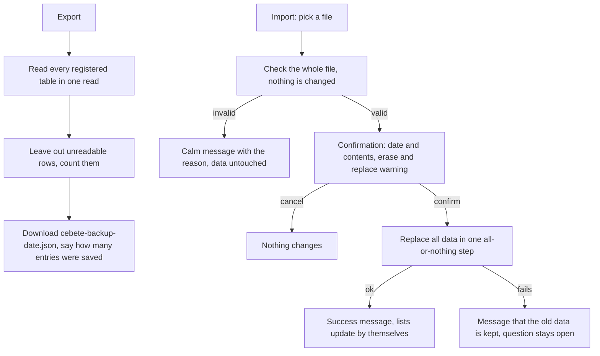

## Summary

Backup lets the user save everything stored in cebete to one file and restore it later, because the data lives only in the browser and a backup is the only safeguard against cleared site data or a new phone. It lives in the Backup section of the Settings screen and works fully offline. It does not cover merging, automatic or scheduled backups, reminders, cloud sync, or encryption.

## How it works

- **Export:** one button builds a backup and downloads it as a single file named with the local date. A calm message says how many entries were saved, and notes any that could not be read and were left out so the backup can always be restored. A failure shows a muted message.
- **Import:** the user picks a file. The app checks it completely before touching anything. A valid file leads to a confirmation that says when the backup was made and what it holds, warns that everything on the device will be erased and replaced and that this cannot be undone, and suggests exporting first. Cancel is the safe, focused choice; confirming replaces the data.
- **Refused files:** a file that is not JSON, is not a cebete backup, is damaged (a bad row, including a thought record with a damaged challenge, a missing table, repeated ids), was made by a newer version of the app, or is too old to read is refused with its own plain-words message. The data is not changed.
- **Older backups:** a backup made at an earlier data version is brought up to date as it is read, using the same conversion as the database upgrade (see [storage](../storage/spec.md)). A version 2 file in the old single-emotion 0 to 100 layout is converted to the current layout, and a version 3 file, made before thought records existed, restores its mood entries and leaves no thought records.
- **Replace:** every backed-up table is cleared and refilled with the backup's rows, ids included, in a single database transaction.

## Data and files

- **File format:** one JSON file with an app marker, a version number (the data schema version), the time it was made, and the rows of each table. It is plain and unencrypted.
- **Registry:** a list of backed-up tables, each with the version it first existed in, a label, how old rows are upgraded, and how a row is checked. A test fails if the database holds a table that is missing from the registry.
- **Code:** `src/backup/` holds the file rules (export, strict parse, restore, errors, wording) and the Backup section with its Export and Import controls. The section is shown on the Settings screen.
- **Tests:** in `tests/backup/` and `tests/screens/`, against a fake IndexedDB.

## Rules and edge cases

- **Nothing changes until the user confirms.** Checking a file never writes to the database, and Cancel leaves the data as it was.
- **All or nothing:** if the replacement fails part-way, the previous data is kept exactly, the user is told, and can retry or cancel.
- **Every table must be registered.** A future module that stores data must join the registry, or the registry test fails.
- A backup from a newer version is never read, so an old app cannot damage data it does not understand.
- Backup files hold private data in plain text; the user must store them carefully.
- Picking the same file twice in a row works.
- Accessibility: focus moves into the confirmation on its safe choice and returns to Import when it closes; results are announced politely; all controls are at least 48 px tall.
- On an iPhone home-screen app, a plain download can be awkward; a share sheet is not built.

## Related

- [storage](../storage/spec.md): the database that is read and replaced, and the version conversion backups reuse.
- [mood-log](../mood-log/spec.md): the mood entries that are backed up.
- [thoughts](../thoughts/spec.md): the thought records, with their challenges, that are backed up.
- [app-shell](../app-shell/spec.md): hosts the Settings screen.
