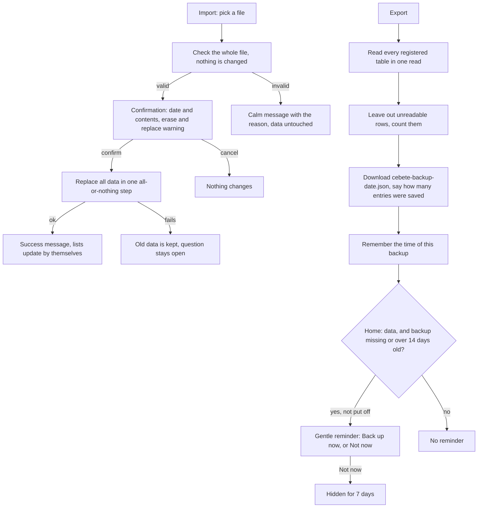

## Summary

Backup lets the user save everything stored in cebete to one file and restore it later, because the data lives only in the browser and a backup is the only safeguard against cleared site data or a new phone. It lives in the Backup section of Settings and works offline. Because a backup is easy to forget, the section shows when the last one was made, and Home shows a gentle reminder when one is overdue. It does not cover merging, automatic or scheduled backups, notifications, cloud sync, or encryption.

## How it works

- **Export:** one button downloads a single file named with the local date. A calm message says how many entries were saved and notes any unreadable ones left out, so the backup can always be restored.
- **Import:** the app checks the picked file completely before touching anything. A valid file leads to a confirmation with the backup's date and contents, a warning that everything on the device will be erased and replaced, and a suggestion to export first. Cancel is the safe, focused choice.
- **Refused files:** a file that is not JSON, not a cebete backup, damaged (a bad row, a missing table, repeated ids), made by a newer app version, or too old is refused with its own plain-words message. Data is unchanged.
- **Older backups:** a backup from an earlier data version is brought up to date as it is read, with the same conversion as the database upgrade (see [storage](../storage/spec.md)). Records made before challenges, tests or body notes existed restore without them, and a backup made before the coping library existed restores with an empty library.
- **Replace:** every backed-up table is cleared and refilled with the backup's rows, ids included, in a single database transaction.
- **Last backup:** the Backup section says "Last backup:" with the day, "Never backed up", or "Last backup: unknown" when the browser cannot say. The time is remembered only when an export succeeds. A failed export and a restore leave it unchanged.
- **The reminder:** Home shows a calm one-line reminder, below the settle card, when the user has data (a mood entry, thought record or coping item) and the last backup is missing or more than 14 days old. "Back up now" opens Settings, and "Not now" hides it for 7 days and moves focus to the page heading. It is never a pop-up, never blocks anything, and sends no notification.

## Data and files

- **File format:** one plain, unencrypted JSON file with an app marker, the data schema version, the time it was made, and the rows of each table.
- **Registry:** the list of backed-up tables, each with the version it first existed in, a label, how old rows are upgraded, and how a row is checked.
- **Device preferences:** the time of the last backup and the "not now" snooze are kept in the browser's own storage, per browser. They are not in the database and not in the backup file, and clearing site data resets them.
- **Code:** `src/backup/` holds the file rules (export, strict parse, restore, errors, wording), the Backup section with its Export and Import controls, shown on the Settings screen, the guarded store for the two preferences with its hook, the rule for when a reminder is due, and the Home reminder. Tests are in `tests/backup/` and `tests/screens/`, against a fake IndexedDB.

## Rules and edge cases

- **Nothing changes until the user confirms.** Checking a file never writes to the database.
- **All or nothing:** if the replacement fails part-way, the previous data is kept exactly, and the user can retry or cancel.
- **Every table must be registered.** A future module that stores data must join the registry, or a test fails.
- A backup from a newer version is never read, so an old app cannot damage data it does not understand.
- Backup files hold private data in plain text; the user must store them carefully.
- **A new user is not nagged:** with nothing stored, there is nothing to lose, so no reminder shows.
- **Blocked storage:** if the browser blocks its storage, the app still works. The last backup shows as unknown, and the reminder stays hidden rather than appear on every visit.
- The reminder judges the time once, when Home opens, so a page left open for days is not re-checked.
- Picking the same file twice in a row works.
- Focus moves into the confirmation on its safe choice and returns to Import on close; results are announced politely; controls are at least 48 px tall.
- On an iPhone home-screen app a plain download can be awkward; a share sheet is not built.

## Related

- [storage](../storage/spec.md): the database that is read and replaced, and the version conversion backups reuse.
- [mood-log](../mood-log/spec.md): the mood entries that are backed up.
- [thoughts](../thoughts/spec.md): the thought records that are backed up.
- [coping](../coping/spec.md): the coping items that are backed up.
- [app-shell](../app-shell/spec.md): hosts the Settings screen and shows the reminder on Home.
