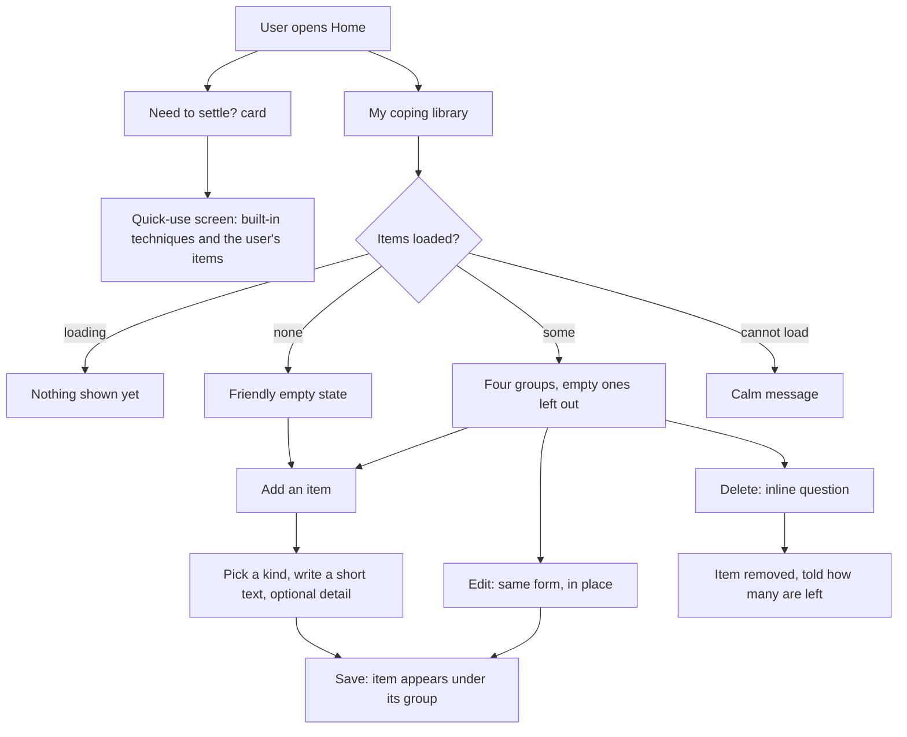

## Summary

Coping is cebete's personal library of things that help the user cope: something to do, something to keep nearby, calming words, and true things about themselves. It is built while calm, so it is to hand when worry rises. It is managed on its own screen, entered from Home, and is kept only on the device. A quick "Need to settle?" screen, also entered from Home, shows the library next to a few built-in techniques, so it helps even before the user has added anything. It does not cover guided animations or timers, photos or files, intensity or tags, or links from thought records or body areas.

## How it works

- **Entry:** Home has a "Need to settle?" card to `/settle` and a "My coping library" link to `/coping`. Neither has a bottom bar item; Home stays highlighted on both (see [app-shell](../app-shell/spec.md)). Each screen has a "Back to home" link.
- **The list:** four groups in a fixed order: Do, Keep nearby, Tell myself, About me. A group with no items is left out. Within a group, items keep the order they were added. While the first read is under way nothing is shown, so the empty state never flashes. If items cannot be loaded, a muted message appears and the rest of the screen keeps working.
- **The kinds:**
  - **Do:** something to do now, such as slow breathing; the detail can hold the steps.
  - **Keep nearby:** an object or place to reach for, such as a stuffed animal.
  - **Tell myself:** calming words, such as "This will pass."
  - **About me:** something true and positive about the user, used as evidence against a worry.
- **Adding:** "Add an item" opens a form in its place: a kind (nothing chosen at first), a short text, and an optional detail, each text field with a length counter, and a short example of the chosen kind. Save is off until a kind is chosen and the text is not blank.
- **Editing:** Edit opens the same form in place, filled in, and the kind can be changed, which moves the item to its new group. A cleared detail is removed.
- **Deleting:** Delete asks "Delete this item? This cannot be undone." inside the item, with Keep focused first. Afterwards a polite announcement says how many items are left and focus moves to the list.
- **One flow at a time:** while the add form, an edit form or the delete question is open, the other actions are switched off, so typed work is never lost silently.
- **The quick-use screen:** built for a hard moment, with no typing and no editing. It shows, in order:
  - **Do:** the built-in techniques first, each with numbered steps, then the user's own actions with their detail.
  - **Keep nearby:** the user's items, with detail.
  - **Tell myself:** the user's calming words, in larger text.
  - **Remember:** the user's About me items, named for what they are in this moment: reminders.

  A group with nothing in it is left out, except Do, which always has the built-in techniques. While the items load the techniques are already shown. Once it is known the library is empty, a gentle prompt invites the user to add items, and a link opens the library. A short calm note says cebete is a self-help tool and not a substitute for professional care or emergency help. The screen follows the library live.

## Data and files

- **Item:** an id, a kind (one of four), a short text, and an optional detail. It lives in the `copingItems` table, ordered by id (see [storage](../storage/spec.md)). The kinds are text only; there are no per-kind fields.
- **Built-in techniques:** slow breathing, grounding (5, 4, 3, 2, 1) and muscle relaxation, each a title and a few plain steps. They are fixed data in code: not stored in the database, not editable, and not part of backups.
- **Code:** `src/coping/` holds the types and labels, validation, reading and writing, a live-query hook, the form, the kind picker, the list and the item row, and for the quick-use screen the built-in techniques and the grouped view. `src/screens/CopingScreen.tsx` is the library and `src/screens/SettleScreen.tsx` the quick-use screen. The delete question is the shared control in `src/shared/`, also used by [thoughts](../thoughts/spec.md). Tests are in `tests/coping/`, `tests/screens/` and `tests/backup/`.
- **Backup:** items are part of every backup (see [backup](../backup/spec.md)).

## Rules and edge cases

- **Limits:** the kind must be one of the four, the short text is required and at most 100 characters, and the detail is at most 500, both after trimming. A blank detail is left out. A broken rule is explained in plain words and nothing is saved.
- **Failures:** if saving or deleting fails, a calm message appears, the form or question stays open and everything typed stays. Buttons are off while saving, so a double tap saves once.
- **An item that is gone:** if an item is deleted while its form is open and Save is pressed, the form says so and offers only Cancel; nothing is recreated. An item that vanishes from the list closes its form.
- **Unreadable rows:** a damaged item is left out of the list, never deleted, and reported once in the console.
- **Accessibility:** forms and headings take focus on opening, closing returns focus to the opener, results such as "Item saved.", "Item updated." and "Item deleted." are announced politely, the kind picker uses real radio buttons, and every control is at least 48 px tall.
- **Quick-use failures:** if the items cannot be read, the built-in techniques still show with a calm message, and the screen does not claim the library is empty.
- **No crisis line:** the calm note names none, because the right one depends on the user's country.
- Items are private and stay on the device; backups are plain and unencrypted. Everything works offline.

## Related

- [app-shell](../app-shell/spec.md): the Home card and link, the addresses, and how Home stays current in the bar.
- [storage](../storage/spec.md): the table that holds the items.
- [backup](../backup/spec.md): includes the items in every backup.
- [thoughts](../thoughts/spec.md): shares the delete question control.
