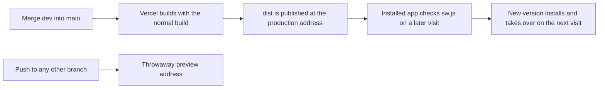

## Summary

cebete is hosted on Vercel as a static site, so the owner can open it, install it and use it offline on a phone. The repository is public and open source under the MIT licence. This doc covers the hosting setup, the rule that the web address is the identity of the data, the checklist for verifying a deployment on a real device, and what the repository shows the public. It does not cover how the app itself works (see [app-shell](../app-shell/spec.md)) or how data is stored (see [storage](../storage/spec.md)).

## How it works

- **Production follows `main`.** Merging `dev` into `main` publishes a new version at the production address. Every other branch gets a throwaway preview address.
- **Every address opens the app.** One catch-all rewrite sends any address to the app page, so a direct link or a reload on `/mood`, `/thoughts/7` or `/settle` shows that screen. Real files (icons, manifest, service worker) are served first, as themselves. An unknown address goes to Home through the app's own routing. No redirects, clean-URL or trailing-slash rules exist, so addresses are never reshaped.
- **Updates reach the installed app.** The service worker and the manifest are always revalidated, never served stale, so a new version is found on a later visit.
- **Page head.** The page carries a description and a theme colour, the same ones the manifest declares.
- **No analytics, no environment variables, no secrets.** The app sends nothing to any server, and "nothing leaves your device" stays simply true.
- **The repository's front page.** The root `README.md` opens with a banner (the logo and the title "cebete" on a teal band, readable on light and dark themes), then says what cebete does, the privacy promise, that it is a self-help tool and not medical advice, how to run it (the Node version, install, start, build, preview and the five checks), the address rule, a credit to the book it draws on (with a note that cebete is independent and not affiliated with or endorsed by its authors or publisher), and the licence. It holds no repository link and no hosted-app link, since GitHub's About section holds them. The `LICENSE` is the standard MIT text for Joshua William, 2026. `.claude/` and `docs/` stay public, and the history is left as it is.

## Data and files

| Where                              | What                                                                          |
| ---------------------------------- | ----------------------------------------------------------------------------- |
| `vercel.json`                      | Vite framework, normal build, `dist` output, the rewrite and the headers      |
| `package.json` (`engines`)         | The Node version the toolchain needs, so the host does not pick an older one  |
| `index.html`                       | Page description and theme colour                                             |
| `.gitignore`                       | Keeps the host's local `.vercel` folder and the book PDF out of git           |
| `README.md`, `LICENSE`             | The repository's front page and its MIT licence                               |
| `assets/`, `scripts/generate-banner.js` | The README banner (an SVG master and a PNG twice its size) and the one-time tool that draws it (`npm run banner`). The lettering is drawn from shapes, not a font. The folder is outside `public/`, so the banner is never shipped in the app |
| `tests/vercel.config.test.ts`, `tests/index.html.test.ts` | Pin the rewrite, the headers, the build settings, the Node version and the page head |
| `tests/openSource.test.ts`, `tests/readme.test.ts`, `tests/banner.test.ts` | Pin the licence text, the ignored PDF, the README's content and rules, and the banner files |

### Hosting steps, once

1. Merge `dev` into `main` on GitHub. Set the default branch to `main`, and the Production Branch to `main` in the Vercel project settings.
2. On vercel.com, sign in with GitHub and import the repository. Vercel detects Vite and `vercel.json` supplies the settings. No environment variables are needed.
3. **Choose the project name before the first deploy.** The production address is built from it, so renaming it later, or adding a custom domain later, changes the address.
4. Leave Vercel's analytics and speed insights off.
5. The free plan is for non-commercial use.

### Device checklist

Run on a phone and again in a desktop browser after a deployment that changes hosting or the service worker.

- **Open the address.** Home loads, with the logo beside the title.
- **Direct links.** `/mood`, `/thoughts`, `/coping` and `/settle` each open their own screen.
- **Reload on a record.** Reloading on an open thought record returns the same record. An unknown address goes to Home.
- **Install.** Android Chrome: Install app. iPhone Safari: Share, then Add to Home Screen. The app opens on its own with its icon.
- **Offline.** After one visit, in airplane mode every screen opens and a new mood entry saves.
- **Save a backup.** Export a backup in Settings, check where the file ends up (iPhone handles downloads differently), then import it and confirm the entries return.
- **Update.** After deploying a visible change, the installed app shows it on a later visit.
- **The address rule.** A preview address shows empty data, which is expected.

## Rules and edge cases

- **The web address is the identity of the data.** The browser keeps the data per exact address. Another domain, a renamed project, a preview address, or `http` instead of `https` shows empty data. Keep one stable production address, treat previews as throwaway, and export a backup before ever changing the address, then import it at the new one.
- **Real files must not be hidden by the rewrite.** The icons, the manifest and the service worker stay real files, never the app page.
- **iPhone storage.** Safari can clear a website's stored data after about a week without use, unless the site is installed to the Home Screen. Installing it and keeping backups are the safeguards (see [backup](../backup/spec.md)).
- **The book PDF is never tracked.** It stays on disk, and `.gitignore` keeps git from offering it.
- **The README stays honest and personal-data free.** It describes only what the app does today, and holds no web address or email. Once the repository is public, everything already in its history stays visible, including the commit email, so the history should be skimmed first.
- **Node version.** The toolchain needs Node 22.12 or newer, so Node 20 is excluded.
- Hosting plan terms may change.
- Storage limits, downloads and installing can only be proven on a real device, not by unit tests.

## Related

- [app-shell](../app-shell/spec.md): the PWA, the addresses and the offline behaviour being hosted.
- [storage](../storage/spec.md): the per-address local database.
- [backup](../backup/spec.md): the export and import used before any change of address.
