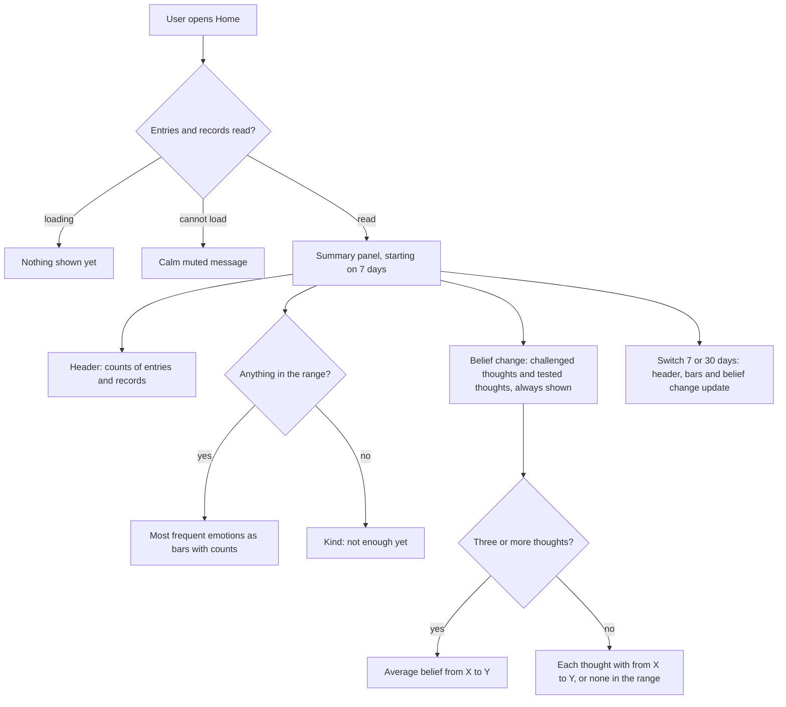

## Summary

Insights turns what the user has logged into short, plain summaries. Today that is one panel on Home: how many mood entries and thought records there were in the last week or month, the emotions named most often, and how strongly thoughts were believed before and after they were challenged or tested. It only reads what Mood and Thoughts already store, keeps nothing of its own, and reports numbers without judging them. It does not cover body areas, a separate Insights screen, links from a thought in the summary to its record, a charting library, streaks, or a single "mood line".

## How it works

- **The panel:** a labelled "Summary" region on Home, below the backup reminder, last on the page. The settle card always stays first (see [app-shell](../app-shell/spec.md)).
- **The toggle:** "7 days" and "30 days", as large real radio buttons. It starts on 7 days at every visit and is not remembered.
- **The range:** the last 7 or 30 days including today, counted by the user's local day, so it begins at local midnight 6 or 29 days ago. Mood entries and thought records are placed by the time they happened. The range has no end, since nothing can have happened later.
- **The header:** a line such as "Last 7 days: 5 mood entries, 3 thought records", with the singular for one and "no" for none. It is announced politely when the range changes.
- **Most frequent emotions:** up to five, most frequent first, as simple horizontal bars sized against the most frequent one. Every emotion in a mood entry or a thought record counts once, so a record with three feelings adds to three emotions. Ties keep the order of the emotion list, so the order never jumps around.
- **Not enough yet:** when the range holds nothing, a kind message says to log a few entries or thoughts, instead of an empty chart.
- **Belief change:** two blocks under the emotions, "Challenged thoughts" and "Tested thoughts", kept apart because the methods differ. Each says how many thoughts fall in the range, then:
  - **Three or more:** "Average belief: from 7.5 to 4", rounded to one decimal, and a whole number without a decimal.
  - **One or two:** each thought's text, kept to a couple of lines on screen, with "from 8 to 4". A small sample would make an average misleading.
  - **None:** a calm "None in the last 7 days." line.

  A challenge compares the record's own belief with the belief after the challenge. A test counts once its result is logged, with the belief after the test, and a test that is only planned counts for nothing. A thought that was both challenged and tested appears in both blocks. Each block follows the same toggle, and thoughts are listed newest first.
- **Where a challenge or test falls in the range:** by the day the challenge was saved or the result logged, not by when the thought happened, so an old thought challenged today counts. A part saved before dates existed has none, and falls back to the time of the thought itself (see [thoughts](../thoughts/spec.md)).
- **Live:** the panel follows the data by itself as entries and records are added, changed or removed.

## Data and files

- **Source:** the mood entries and thought records, read through their existing live queries (see [mood-log](../mood-log/spec.md) and [thoughts](../thoughts/spec.md)). Nothing is stored, and nothing is added to backups.
- **Code:** `src/insights/` holds the range rule, the counting, the header wording, the belief-change calculation and its blocks, the combined data hook, the toggle, the bars and the panel. The panel is placed by `src/screens/HomeScreen.tsx`. Tests are in `tests/insights/`, `tests/screens/` and `tests/`.
- **Drawn by the app:** the bars are plain styled boxes, with no charting library, to keep the app small.

## Rules and edge cases

- **Emotions are counted, not scored.** The twelve emotions mix pleasant and unpleasant ones, and "tired" fits neither side, so there is no single mood line.
- **Neutral wording:** the panel reports counts and beliefs and nothing else. No streaks, no "better" or "worse". A belief that went up reads "from 4 to 6" as plainly as one that dropped.
- **Belief blocks always show,** even when the emotions part says "not enough yet", because a thought from before the range can have been challenged inside it.
- **Readable in order:** each block is a labelled section with its own heading, and nothing relies on colour.
- **Text for every bar:** each row says its emotion and its count in words ("Named 3 times"), and the bar itself is hidden from assistive technology. Nothing relies on colour alone.
- **Never flashes:** nothing is shown until both lists are read, so the empty message does not appear by mistake.
- **Failure:** if the data cannot be read, a muted message replaces the panel and the rest of Home keeps working. It never claims the library is empty.
- **Unreadable rows:** a damaged entry or record is left out, as everywhere else.
- **Time is taken once:** the panel judges "today" when it first appears, so a page left open past midnight is not re-counted until it is reopened.
- Controls are at least 48 px tall and the look stays calm. Everything works offline.

## Related

- [app-shell](../app-shell/spec.md): Home, where the panel sits.
- [mood-log](../mood-log/spec.md): the mood entries it counts.
- [thoughts](../thoughts/spec.md): the thought records it counts.
