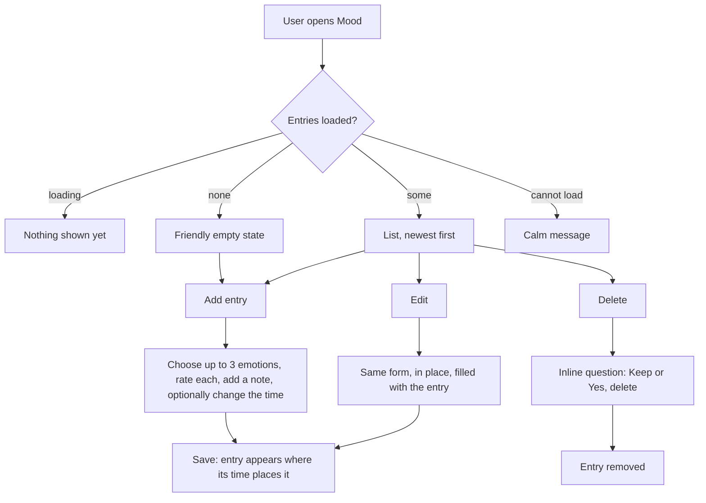

## Summary

The mood log is cebete's first CBT feature: a private log, kept only on the device, of how the user feels. Each entry records one to three emotions, each rated from 0 to 10, with an optional short note and the date and time it happened. Entries can be added, edited and deleted, and the user can choose when a feeling happened. It does not cover an edit history, trends and insights, or linking entries to thoughts. Entries are included in backups (see [backup](../backup/spec.md)).

## How it works

- **The list:** newest first by the time recorded on each entry, and it updates by itself whenever the stored data changes. Each entry shows every emotion with its rating out of 10, then the note if there is one, and the time. While the first read is under way nothing is shown, so the empty state never flashes by mistake. If the entries cannot be loaded, a calm, muted message appears and the rest of the screen keeps working.
- **Adding:** a full-width "Add entry" button opens the form.
  - The user taps up to three emotions, and taps a chosen one again to remove it. Once three are chosen, the others fade out and a calm message says that is the most, and to remove one first.
  - Each chosen emotion gets its own 0 to 10 slider, labelled with its name, starting at 5, with its number always visible. Removing an emotion drops its rating, and choosing it again starts at 5.
  - An optional note has a visible length counter.
  - A "Date and time" picker, filled with the current moment, sits above the buttons. Left alone, the entry is stamped with the exact moment it is saved, even if the form was open for a while. Changed, the entry is saved with the chosen time.
  - Save is available once at least one emotion is chosen. On success the form closes and the new entry appears where its time places it in the list. Cancel saves nothing. If saving fails, a calm message appears and everything the user chose and typed stays, so they can try again.
- **Editing:** each entry has an Edit action next to Delete. It opens the same form in place of the entry, titled "Edit entry", filled with the entry's emotions, ratings, note and time. Saving updates the entry in place, keeping its identity, and it moves to its new place if its time changed. A cleared note is removed. Cancel leaves the entry untouched. If the entry was deleted meanwhile, the form says so and offers only Cancel, and nothing is recreated.
- **One form at a time:** while the add form or an edit form is open, the other Edit actions and Add entry are switched off, so typed work is never lost silently.
- **Deleting:** each entry has a Delete action that asks "Delete this entry? This cannot be undone." with Keep and Yes, delete, right inside the entry. If deleting fails, a calm message appears and the question stays.
- **Keyboard and screen readers:** focus moves into the form when it opens, and back to "Add entry" (or to the entry's Edit action) when it closes. After a save from an edit, a spoken note says "Entry updated.". When the delete question opens, focus lands on the safe choice, Keep. After a delete, focus returns to the list and a spoken note says "Entry deleted" and how many are left. Emotions are real checkboxes, ratings are sliders named like "Anxious intensity" with spoken values, and the Delete action names every emotion of its entry.

## Data and files

- **Entry:** an id, a list of one to three emotion-and-rating pairs in the order chosen, an optional note, and the time it was recorded. It lives in the `moodEntries` table (see [storage](../storage/spec.md)).
- **Emotion-and-rating pair:** a small shape that stands on its own. The thought record (see [thoughts](../thoughts/spec.md)) reuses it, together with the emotion picker, the rating sliders, the emotion and time checks and the date helpers, which stay in this module.
- **Emotions:** a preset list of twelve, mixing pleasant and unpleasant: calm, happy, grateful, hopeful, content, tired, sad, anxious, stressed, angry, lonely and overwhelmed.
- **Libraries:** Dexie live queries through `dexie-react-hooks`, Chakra UI, and `react-icons`.
- **Code:** `src/mood/` holds the types and limits, the emotion list, validation, reading, adding, editing and deleting entries, the date and time helpers, the conversion of old entries, the live-query hook, and the form, picker, ratings, list and entry components. `src/screens/MoodScreen.tsx` is the screen. Tests are in `tests/mood/` and `tests/screens/`.

## Rules and edge cases

- **Limits:** one to three emotions, none repeated, each from the list; each rating a whole number from 0 to 10; a note of at most 500 characters after trimming. A blank note is left out instead of saved.
- **Enforced when saving:** the rules apply to adding and editing alike, whatever the screen does, a broken rule is explained in plain words, and nothing is saved when an entry is rejected.
- **The time:** a new entry is stamped with the moment it is saved unless the user chooses one. A chosen or edited time must be a real date and time and cannot be in the future; otherwise it is refused in plain words and nothing is saved. A time the user did not change is kept exactly, to the millisecond, not rounded to the minute the picker shows. Entries with the same time keep their save order.
- **Unreadable rows:** a stored row that cannot be read as an entry, such as a damaged one, is left out of the list so it cannot break it. It is not deleted, and it is reported once per page load in the browser console.
- **Older entries:** entries saved when the log held a single emotion rated 0 to 100 are converted automatically (see [storage](../storage/spec.md)).
- **Safe against double taps:** while saving, editing or deleting, the buttons are switched off, so two taps make one entry or one delete.
- **No undo:** deleting cannot be undone, and an edit replaces the old values. There is no edit history.
- **Touch and look:** every control is at least 48 px tall, and warnings use the calm muted colours of the theme (see [app-shell](../app-shell/spec.md)).
- Everything works fully offline and was verified in a real browser, including after reloading and after closing and reopening the browser.

## Related

- [storage](../storage/spec.md): the table that holds the entries, and how older entries are upgraded.
- [app-shell](../app-shell/spec.md): the Mood section, the theme and the bottom bar around the log.
- [thoughts](../thoughts/spec.md): reuses the emotion picker, sliders and checks.
