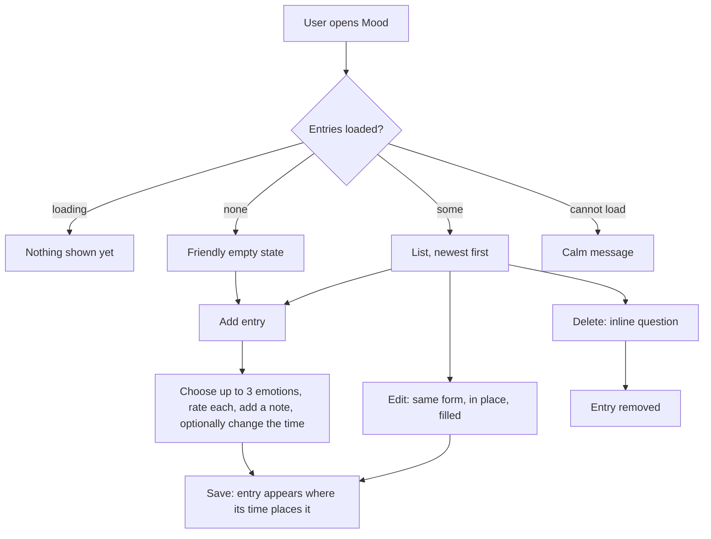

## Summary

The mood log is cebete's first CBT feature: a private log, kept only on the device, of how the user feels. Each entry records one to three emotions, each rated 0 to 10, with an optional short note and the time it happened, which the user can choose. Entries can be added, edited and deleted. It does not cover an edit history, trends and insights, or linking entries to thoughts. Entries are included in backups (see [backup](../backup/spec.md)).

## How it works

- **The list:** newest first by the entry's time, updating by itself when stored data changes. Each entry shows every emotion with its rating out of 10, the note if any, and the time. While the first read is under way nothing is shown, so the empty state never flashes. If entries cannot be loaded, a muted message appears and the rest of the screen keeps working.
- **Adding:** "Add entry" opens the form. The "Log how I feel" quick action on Home opens Mood with the form already open (see [app-shell](../app-shell/spec.md)); Cancel then leaves the user on Mood with the list.
  - The user taps up to three emotions (tap again to remove). At three, the others fade and a calm message says that is the most.
  - Each chosen emotion gets a 0 to 10 slider starting at 5. Removing an emotion drops its rating.
  - An optional note has a length counter. A "Date and time" picker starts at the current moment; left alone, the entry is stamped with the moment it is saved, otherwise with the chosen time.
  - Save is available once one emotion is chosen. If saving fails, a calm message appears and everything typed stays.
- **Editing:** the same form opens in place of the entry, titled "Edit entry", filled with its values. Saving keeps the entry's identity and moves it if its time changed; a cleared note is removed. If the entry was deleted meanwhile, the form says so and offers only Cancel.
- **Deleting:** asks "Delete this entry? This cannot be undone." inside the entry, with Keep and Yes, delete. A failed delete shows a calm message and keeps the question.
- **One form at a time:** while a form is open, Add entry and the other Edit actions are off, so typed work is never lost silently.
- **Keyboard and screen readers:** focus moves into the form on opening and back to the opener on closing; the delete question starts on Keep; saves and deletes are announced politely. Emotions are real checkboxes and ratings are named sliders with spoken values.

## Data and files

- **Entry:** an id, one to three emotion-and-rating pairs in the order chosen, an optional note, and the time. It lives in the `moodEntries` table (see [storage](../storage/spec.md)).
- **Emotion-and-rating pair:** a standalone shape. The thought record (see [thoughts](../thoughts/spec.md)) reuses it, with the emotion picker, rating sliders, emotion and time checks and date helpers, which stay in this module.
- **Emotions:** a preset list of twelve: calm, happy, grateful, hopeful, content, tired, sad, anxious, stressed, angry, lonely and overwhelmed.
- **Code:** `src/mood/` holds the types, validation, reading and writing, date helpers, the conversion of old entries, the live-query hook, and the form, picker, ratings, list and entry components. `src/screens/MoodScreen.tsx` is the screen. Tests are in `tests/mood/` and `tests/screens/`.

## Rules and edge cases

- **Limits:** one to three distinct emotions from the list; ratings are whole numbers 0 to 10; a note is at most 500 characters after trimming, and a blank note is left out. The rules apply to adding and editing alike, and a rejected entry is explained in plain words and not saved.
- **The time:** a chosen time must be real and not in the future. A time the user did not change is kept exactly, to the millisecond. Entries with the same time keep their save order.
- **Unreadable rows:** a damaged row is left out of the list, never deleted, and reported once per page load in the console.
- **Older entries:** entries saved when the log held one emotion rated 0 to 100 are converted automatically (see [storage](../storage/spec.md)).
- **Double taps and undo:** buttons are off while saving, editing or deleting, so two taps make one change. Deleting cannot be undone, and an edit replaces the old values.
- **Touch and look:** controls are at least 48 px tall, and warnings use the calm muted theme (see [app-shell](../app-shell/spec.md)). Everything works offline.

## Related

- [storage](../storage/spec.md): the table that holds the entries, and how older entries are upgraded.
- [app-shell](../app-shell/spec.md): the Mood section, the theme and the bottom bar.
- [thoughts](../thoughts/spec.md): reuses the emotion picker, sliders and checks.
- [insights](../insights/spec.md): counts the entries and their emotions in the Home summary.
