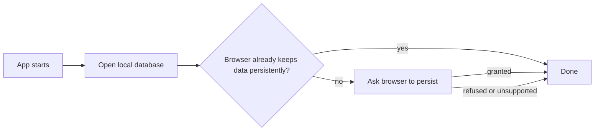

## Summary

Storage is cebete's local-only data layer: an IndexedDB database managed through Dexie, with a versioned schema that feature modules extend. All user data lives on the device and is never sent to a server. It currently holds the mood entries (see [mood-log](../mood-log/spec.md)) and the thought records (see [thoughts](../thoughts/spec.md)), and it does not include sync. Backup and restore are in [backup](../backup/spec.md).

## How it works

- **Startup:** when the app starts it opens the database and asks the browser to keep the stored data instead of evicting it under storage pressure. This runs alongside rendering and never delays the first screen.
- **Refusal is fine:** if the browser refuses, does not support the request, or the request fails, the app carries on normally. The request is repeated at each start until the browser grants it.
- **Growing the schema:** a feature module adds its tables by declaring a new schema version. Dexie migrates existing data to it.
- **Upgrading entries:** when the app opens a database made by an older version, the entries in it are converted automatically. Going from version 2 to 3 turns each entry that has one emotion rated 0 to 100 into an entry with one emotion rated 0 to 10: the rating is divided by 10, rounded, and kept inside 0 to 10. The id, note and time are kept, and the old fields are removed.
- **Failure to open:** if the database cannot be opened, the error is reported to the console and the app still renders.

## Data and files

- **Library:** Dexie on IndexedDB. The database is named `cebete`.
- **Schema:** currently version 4, with two tables, `moodEntries` and `thoughtRecords`, each listed by the time its rows were recorded. A thought record can carry an optional challenge inside the same row, which needed no new version. Versions 1 to 3 stay declared, because a device may still hold a database made by one of them. Dexie stores the version internally at ten times its declared value.
- **Code:** `src/db/`, with the database definition, the persistence request, and the startup routine that combines them. Startup is called from `src/main.tsx`. The conversion of old entries is a separate pure function in `src/mood/migration.ts`, which the database upgrade uses.
- **Tests:** in `tests/db/`, run against an in-memory IndexedDB (`fake-indexeddb`), so no real browser is needed. They include upgrading databases built in the older layouts.

## Rules and edge cases

- The schema is versioned from the start; later changes must add a version instead of editing an old one.
- **Every table must be registered for backup.** A test fails if a table exists that the backup does not cover (see [backup](../backup/spec.md)). The backup file carries the schema version, so a new version also means older backups need a conversion.
- **An upgrade must never stop the app from opening.** The conversion of old entries never throws. A row it does not recognise, because it is already converted or damaged, is left exactly as it is and never deleted, and the mood list leaves out rows it cannot read. Running the conversion again changes nothing.
- **The conversion is lossy and cannot be undone.** The 0 to 100 scale becomes 0 to 10, so old ratings of 1 to 4 become 0 and a rating of 5 becomes 1. Exporting a backup first keeps the old ratings (see [backup](../backup/spec.md)).
- No user data leaves the device. A browser check of the production build showed every request going to the app's own origin.
- Clearing site data in the browser erases all stored data. Persistent storage lowers the risk of eviction but does not remove it, and a headless browser refuses it.
- Firefox may show its permission prompt again at a later start after a refusal.

## Related

- [app-shell](../app-shell/spec.md): starts storage and provides the offline-capable app around it.
- [mood-log](../mood-log/spec.md): the feature that stores its entries here.
- [thoughts](../thoughts/spec.md): the feature that stores its records here.
- [backup](../backup/spec.md): exports and restores everything stored here.
