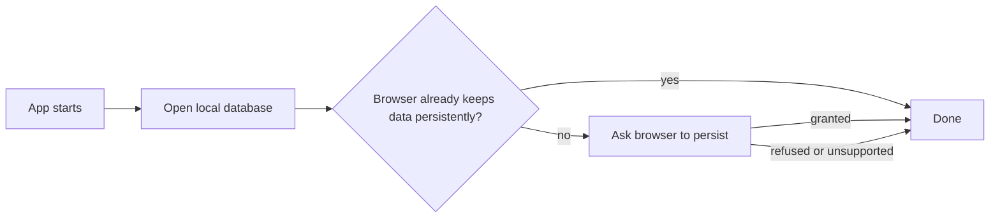

## Summary

Storage is cebete's local-only data layer: an IndexedDB database managed through Dexie, with a versioned schema that feature modules extend. All user data lives on the device and is never sent to a server. It does not yet hold any tables, and it does not include backup or sync.

## How it works

- **Startup:** when the app starts it opens the database and asks the browser to keep the stored data instead of evicting it under storage pressure. This runs alongside rendering and never delays the first screen.
- **Refusal is fine:** if the browser refuses, does not support the request, or the request fails, the app carries on normally. The request is repeated at each start until the browser grants it.
- **Growing the schema:** a feature module adds its tables by declaring a new schema version. Dexie migrates existing data to it.
- **Failure to open:** if the database cannot be opened, the error is reported to the console and the app still renders.

## Data and files

- **Library:** Dexie on IndexedDB. The database is named `cebete`.
- **Schema:** currently version 1 with no tables. Dexie stores the version internally at ten times its declared value.
- **Code:** `src/db/`, with the database definition, the persistence request, and the startup routine that combines them. Startup is called from `src/main.tsx`.
- **Tests:** in `tests/db/`, run against an in-memory IndexedDB (`fake-indexeddb`), so no real browser is needed.

## Rules and edge cases

- The schema is versioned from the start; later changes must add a version instead of editing an old one.
- No user data leaves the device. A browser check of the production build showed every request going to the app's own origin.
- Clearing site data in the browser erases all stored data. Persistent storage lowers the risk of eviction but does not remove it, and a headless browser refuses it.
- Firefox may show its permission prompt again at a later start after a refusal.

## Related

- [app-shell](../app-shell/spec.md): starts storage and provides the offline-capable app around it.
