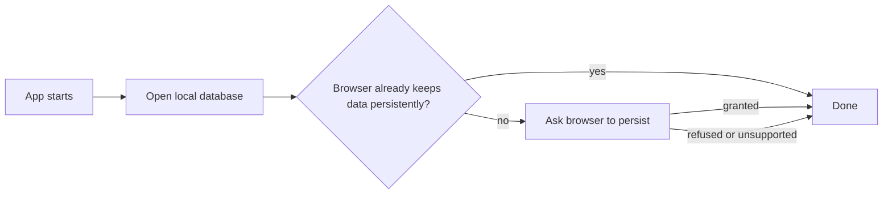

## Summary

Storage is cebete's local-only data layer: an IndexedDB database managed through Dexie, with a versioned schema that feature modules extend. All user data lives on the device and is never sent to a server. It holds the mood entries (see [mood-log](../mood-log/spec.md)) and the thought records (see [thoughts](../thoughts/spec.md)). It does not include sync; backup and restore are in [backup](../backup/spec.md).

## How it works

- **Startup:** the app opens the database and asks the browser to keep the data instead of evicting it under storage pressure. This runs alongside rendering and never delays the first screen.
- **Refusal is fine:** if the browser refuses, does not support the request, or it fails, the app carries on. The request repeats at each start until granted.
- **Growing the schema:** a feature module adds tables by declaring a new schema version, and Dexie migrates existing data.
- **Upgrading entries:** going from version 2 to 3 converts each mood entry with one emotion rated 0 to 100 into one rated 0 to 10 (divided by 10, rounded, kept within range). Id, note and time are kept.
- **Failure to open:** the error is reported to the console and the app still renders.

## Data and files

- **Library:** Dexie on IndexedDB, database named `cebete`.
- **Schema:** version 4, with two tables, `moodEntries` and `thoughtRecords`, each listed by the time its rows were recorded. A thought record's challenge, test and body notes live inside the same row and needed no new version. Versions 1 to 3 stay declared, because a device may still hold an older database.
- **Code:** `src/db/` holds the database definition, the persistence request, and the startup routine called from `src/main.tsx`. The conversion of old entries is a pure function in `src/mood/migration.ts`. Tests are in `tests/db/`, against `fake-indexeddb`, including upgrades from the older layouts.

## Rules and edge cases

- The schema is versioned from the start; later changes add a version instead of editing an old one.
- **Every table must be registered for backup**, or a test fails (see [backup](../backup/spec.md)). A new version also means older backups need a conversion.
- **An upgrade must never stop the app from opening.** The conversion never throws; a row it does not recognise is left exactly as it is, never deleted, and running it again changes nothing.
- **The conversion is lossy and cannot be undone:** old ratings of 1 to 4 become 0 and 5 becomes 1. Exporting a backup first keeps the old ratings.
- No user data leaves the device.
- Clearing site data erases everything. Persistent storage lowers the risk of eviction but does not remove it.

## Related

- [app-shell](../app-shell/spec.md): starts storage and provides the offline-capable app around it.
- [mood-log](../mood-log/spec.md): stores its entries here.
- [thoughts](../thoughts/spec.md): stores its records here.
- [backup](../backup/spec.md): exports and restores everything stored here.
