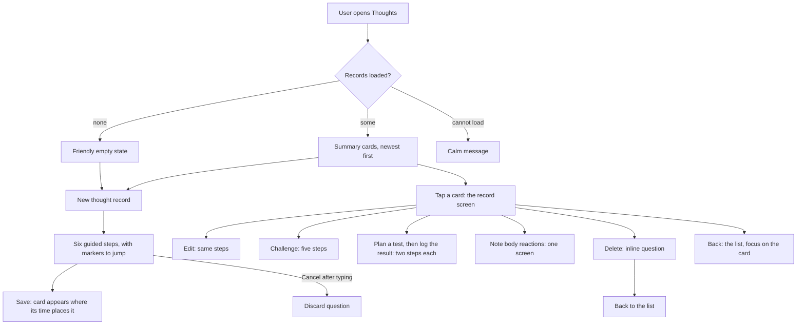

## Summary

Thoughts is cebete's thought record: a private, on-device place to capture an upsetting situation and the automatic thought behind it, rated for belief. Each record can later be challenged, tested in real life, and noted for body reactions. It is the Thoughts section of the app, next to Mood: a list of summary cards, and one screen per record. It does not cover repeated challenges or tests with a history, a body diagram, patterns over time, reminders, or links to mood entries.

## How it works

- **The section:** a Thoughts item in the bottom bar, at `/thoughts`, with a calm line saying it is a self-help tracker and not professional care. While the first read is under way nothing is shown, so the empty state never flashes by mistake. If records cannot be loaded, a muted message appears and the rest of the screen keeps working.
- **The list:** cards newest first by the time the thought happened. A card shows the situation (small, muted), the thought, the date and time, and a checkmark line for each completed part: "Challenged", "Tested", "Body noted". A planned test is not completed. The whole card is one link to the record, and cards are inert while a capture flow is open.
- **Guided flows:** every flow shows one question per screen with a "Step n of N" line, numbered step markers, Back, and Cancel. On an optional step the main button reads Skip while empty and Next once filled; on a required step Next is off until filled, with a hint. Markers jump back freely and forward only up to the first empty required step; when editing every step is reachable. Jumping keeps what was typed.
- **Capture (6 steps):** situation (optional), up to three feelings each rated 0 to 10 (Mood's picker and sliders), what the user did (optional), the thought, belief 0 to 10 (starts at 5), and when it happened (starts now). Nothing is saved before the last step. An untouched time is stamped at the moment of saving.
- **The record screen:** `/thoughts/:id`, with a "Back to thoughts" link and a heading that takes focus. Each part is its own card: the thought (with Edit), Challenge, Test, Body, and Delete this record.
- **Edit:** the same six steps, filled with the record's values. Editing changes nothing in the challenge's evidence, the test or the body notes.
- **Challenge (5 steps):** evidence for and against (optional), a balanced thought (required), belief now, and the record's own feelings re-rated. The original thought stays visible above. The saved part shows the evidence, the balanced thought, belief and feelings before and now, and "Challenged on" with the date. It can be revised.
- **Test:** one per record, no challenge needed. "Plan a test" has two required steps: how and when, and the prediction. It saves as a planned test. "Log the result" has two steps: what happened (required) and belief now. The done test shows both, the belief before and now, and "Tested on" with the date the result was logged; a planned test shows no date. Either stage can be revised; revising the plan of a logged test keeps its result. A plan, until a result is logged, can be removed after a question; a logged test can only be revised.
- **Body reactions:** one screen of seven areas (head, throat and neck, chest, stomach, hands, legs, whole body) as large checkbox chips, each chosen area with an optional short description. Save is off until something changed. Saving with no areas returns the part to its prompt. Set on the record screen only.
- **Delete:** an inline "Delete this record?" question, Keep focused first. It removes the challenge, test and body notes too, returns to the list, and announces how many records remain.
- **Coming back:** the link and the browser's back button return to the list with focus on the card that was opened.
- **Discarding:** Cancel after anything was entered asks to discard, with Keep editing focused first. An untouched flow just closes.
- **One flow at a time:** while any flow or question is open on the record screen, the other actions there are off, so typed work is never lost silently.

## Data and files

- **Record:** an id, an optional situation, one to three emotion-and-rating pairs (same shape as Mood), an optional "what I did", the thought, a belief 0 to 10, and the time. It lives in the `thoughtRecords` table, listed by time (see [storage](../storage/spec.md)).
- **Optional parts of the same row**, with no extra table or database version:
  - **Challenge:** evidence for and against, the balanced thought, the belief now, the record's emotions re-rated, and the moment this version was saved.
  - **Test:** either planned (how and when, prediction) or done (the same plus what happened, the belief now, and the moment the result was logged), so a half-filled test cannot exist.
  - **Body notes:** a list of notes, each an area from the fixed set and an optional description, stored in the set's order. Saving none removes the part.
- **Code:** `src/thoughts/` holds the types, validation, reading and writing, live-query hooks, the shared step flow and markers, the capture, challenge, plan and result flows, the body form, the list and card, and the record screen's parts. `src/screens/ThoughtsScreen.tsx` is the list and `src/screens/ThoughtRecordScreen.tsx` the record screen. Tests are in `tests/thoughts/`, `tests/screens/` and `tests/backup/`.
- **Shared with Mood:** the emotion picker, sliders, and the emotion and time checks stay in `src/mood/` (see [mood-log](../mood-log/spec.md)).

## Rules and edge cases

- **Limits:** the thought and at least one feeling are required. The balanced thought, the test's how and when, its prediction and its result are required for their parts. Beliefs are whole numbers 0 to 10. Text answers are at most 500 characters after trimming; blank optional answers are left out. A time must be real and not in the future. A broken rule is explained in plain words and nothing is saved.
- **Dates of a challenge and a test:** they are stamped by the app, never chosen by the user. Every challenge save is dated now, so the latest save wins. A result is dated when first logged, and again when its result or belief changes. Revising only the plan of a logged test keeps the result's date, and a planned test has none. Editing the thought keeps both dates, and deleting the record deletes them.
- **Undated parts:** a challenge or result saved before dates existed has none and is not backfilled. It shows no date, and anything that needs one falls back to the time of the thought. A date that is present but not a real moment makes that part damaged, like any other bad part.
- **Challenge feelings follow the record:** they must be exactly the record's own emotions. When the record's feelings are edited, remaining ones keep their challenge rating, new ones start at the record's rating, and removed ones drop theirs.
- **Failures:** if saving, deleting or removing fails, a calm message appears, the flow stays open and everything typed stays. Buttons are off while saving, so a double tap saves once.
- **A record that is not there:** an unknown or invalid id, or a row that cannot be read, shows a calm message and a way back. If the record is deleted while its screen or a flow is open, the screen switches to that message and nothing is recreated.
- **Unreadable rows:** a damaged row, including damaged challenge, test or body notes, is left out of the list and treated as missing on its own screen. It is never deleted, and is reported once in the console.
- **Addresses:** a record address works on reload, including offline, and keeps Thoughts highlighted in the bottom bar (see [app-shell](../app-shell/spec.md)).
- **Accessibility:** headings take focus on opening and after each step; closing a flow returns focus to the control that opened it; results such as "Record deleted." are announced politely. Every control is at least 48 px tall, step markers fit a 360 px phone, and colours follow the calm muted theme.
- **Privacy:** records are very personal, stay on the device, and backups are plain and unencrypted. Everything works offline.

## Related

- [mood-log](../mood-log/spec.md): the feelings steps reuse its picker, sliders and checks.
- [storage](../storage/spec.md): the table that holds the records.
- [backup](../backup/spec.md): includes the records, with their challenges, tests and body notes.
- [app-shell](../app-shell/spec.md): the Thoughts section, the record address and the bottom bar.
