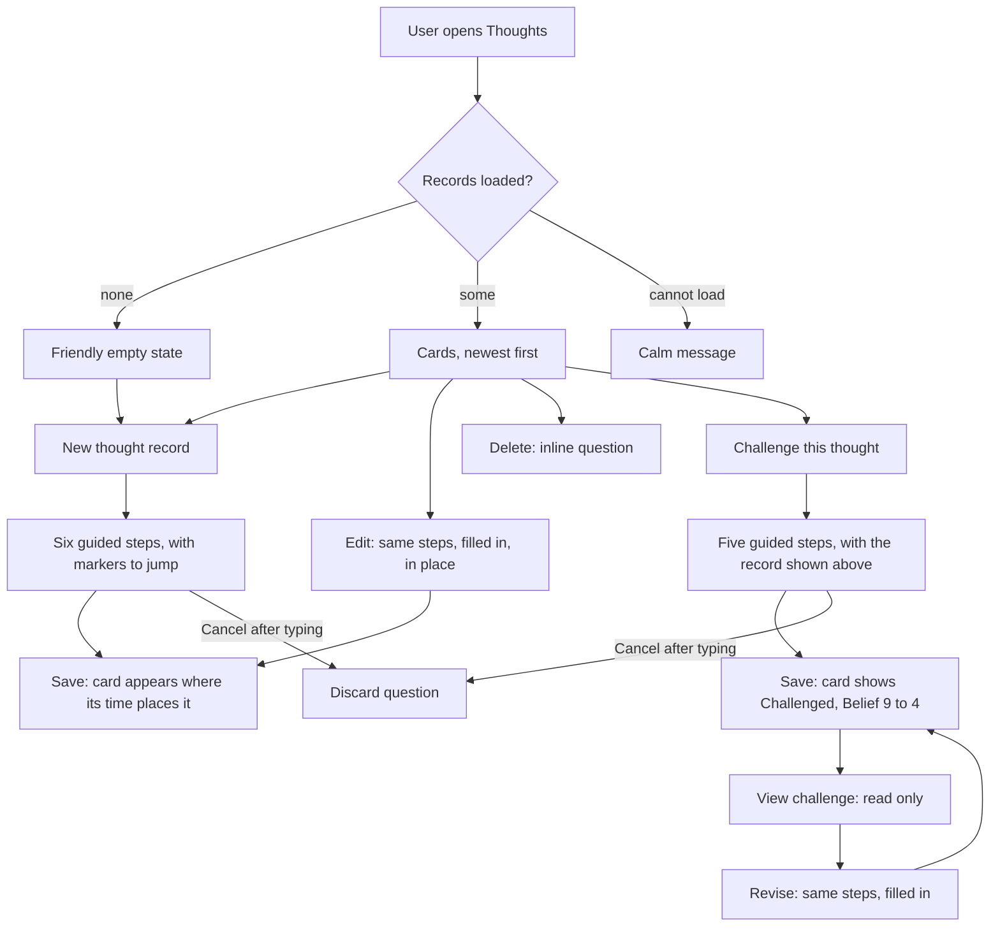

## Summary

Thoughts is cebete's thought record: a private, on-device place to capture an upsetting situation and the automatic thought behind it, rated for how strongly it is believed, and later to challenge that thought and see the belief and feelings change. It is the Thoughts section of the app, next to Mood, and it works like Mood, with a list of cards, Edit and Delete. It does not cover real-world experiments, repeated challenges with a history, body sensations, reminders, a per-record address, or links to mood entries.

## How it works

- **The section:** a Thoughts item in the bottom bar, at `/thoughts`. A calm line says it is a self-help tracker, not a substitute for professional care. Below are the "New thought record" button and the list. While the first read is under way nothing is shown, so the empty state never flashes by mistake. If the records cannot be loaded, a calm, muted message appears and the rest of the screen keeps working.
- **The guided capture:** one question per screen, in place of the button, with a "Step n of 6" line and Cancel.
  1. The situation (optional).
  2. How the user felt: up to three emotions, each rated 0 to 10, using Mood's picker and sliders.
  3. What the user did (optional).
  4. The automatic thought.
  5. How strongly it is believed, 0 to 10, starting at 5.
  6. When it happened, a date and time field starting at the current moment.
- **Moving between steps:** Back is on every step but the first. On an optional step, the main button reads Skip while it is empty and Next once it has text. On a required step, Next is switched off until the step is filled, with a hint saying why. The last step has Save. This is shared by every guided flow here.
- **Step markers:** a row of numbered markers above the question lets the user jump to any step. The current one is highlighted and finished ones are filled. Going back is always allowed. Going forward is allowed only up to the first required step still empty; a blocked marker is marked as disabled but stays focusable, with a description that says what is needed. When editing, every step is reachable at once. A jump keeps everything typed.
- **Saving a record:** nothing is saved before the last step. An untouched time is stamped with the exact moment of saving, even if the flow was open for a while. A chosen time is kept. The card appears in the list, newest first by its time.
- **Cards:** the situation as a small muted line, the thought as the main text, each feeling with its rating, the belief, and the date and time, with Edit and Delete. An unchallenged card also has a full-width primary button, "Challenge this thought", above the date row.
- **Editing:** Edit opens the same steps in place of the card, filled with its values, starting at the first step. Saving updates the card, which moves if its time changed. A time left untouched is kept exactly. A challenge the record already has is kept.
- **Deleting:** Delete asks "Delete this record? This cannot be undone." inside the card, with Keep focused first. Deleting a record deletes its challenge.
- **The challenge:** "Challenge this thought" opens a guided flow in place of the card, with a "Challenge · Step n of 5" line, the step markers and Cancel.
  1. What speaks for the thought (optional).
  2. What speaks against it (optional).
  3. A more balanced thought, which is required.
  4. How strongly the original thought is believed now, starting at the original rating.
  5. How the user feels now: the record's own emotions, each re-rated 0 to 10, starting at their original ratings. Emotions cannot be added or removed here.
- **The record shown while challenging:** between the markers and the question, the thought stays visible as one line. A "See the whole record" button, which reads "Hide the record" while open and announces whether it is expanded, shows the other five parts as they were captured: the situation, the feelings with their ratings, what the user did, the belief, and when it happened. A part the record does not have is left out. The choice stays across steps, jumps and the discard question. It always shows the original record, also when revising.
- **After a challenge:** the card shows a calm "Challenged" label, the balanced thought and the belief as "9 → 4", with a spoken form such as "from 9 to 4 out of 10". The primary button becomes "View challenge".
- **Viewing and revising:** "View challenge" opens a read-only view in place of the card: the situation, the thought, what the user did, the evidence given, the balanced thought, and the belief and each feeling before and now. Nothing there can be edited. Close returns to the card. "Revise challenge" opens the challenge flow filled with the saved challenge, with every step reachable, and saving replaces it.
- **Closing:** Cancel after anything was entered or changed asks "Discard this record?" or "Discard this challenge?", with Keep editing focused first. Closing an untouched flow just closes it. While the question is open, the step markers and the shown record are hidden.
- **One flow at a time:** while the capture, an edit, a challenge or a challenge view is open, "New thought record" and every Edit and Challenge action are switched off, so typed work is never lost silently.

## Data and files

- **Record:** an id, an optional situation, one to three emotion-and-rating pairs in the order chosen (the same shape as Mood), an optional "what I did", the thought, a belief from 0 to 10, and the time it happened. It lives in the `thoughtRecords` table, listed by time (see [storage](../storage/spec.md)).
- **Challenge:** an optional part of the same record, not a separate table: the evidence for and against (both optional), the balanced thought, the belief now, and the record's own emotions re-rated. Records without one are valid and show as not challenged. Adding it needed no new database version.
- **Code:** `src/thoughts/` holds the types, validation, reading and writing, the live-query hook, the shared step flow shell and the step markers, the capture and challenge flows with their step components, the record summary, the card, the challenge view and the list. `src/screens/ThoughtsScreen.tsx` is the screen. Tests are in `tests/thoughts/` and `tests/backup/`.
- **Shared with Mood:** the emotion picker, the rating sliders, the emotion check, the time check and the date helpers stay in `src/mood/` and are imported from there (see [mood-log](../mood-log/spec.md)).
- **Backup:** records, with their challenges, are part of the backup (see [backup](../backup/spec.md)).

## Rules and edge cases

- **Limits:** the thought and at least one feeling are required. The balanced thought is required for a challenge. The text answers are at most 500 characters after trimming, and a blank optional answer is left out instead of saved. A time must be a real moment and not in the future. A broken rule is explained in plain words and nothing is saved.
- **The challenge's feelings:** they must be exactly the record's own emotions, each from 0 to 10. When the record's feelings are edited, the challenge follows: emotions that remain keep their challenge rating, new ones start at their rating in the record, and removed ones drop theirs, so the view never shows a rating for a feeling the record no longer has.
- **Failure to save:** a calm message appears, the flow stays open, and everything typed stays. The buttons are switched off while saving, so a double tap saves once.
- **A record deleted meanwhile:** if the record is deleted while a flow or view is open in this screen, it closes with a calm notice and nothing is recreated. If the delete happens just before Save, the flow says so and offers only Close.
- **Unreadable rows:** a stored row that cannot be read as a record, including one whose challenge is damaged, is left out of the list, never deleted, and reported once per page load in the browser console.
- **Accessibility:** focus moves to the step heading on opening and after every step change or jump, and returns to the control that opened the flow. After a challenge or its view closes, focus returns to the card's primary button, which stays the same button when it changes from "Challenge this thought" to "View challenge". Results such as "Record updated.", "Challenge saved." and "Record deleted" are announced politely. Every control, including each step marker and the record button, is at least 48 px tall, and the markers fit a 360 px phone. Colours follow the calm muted theme.
- **Privacy:** records hold very personal text and stay on the device. Backup files are plain and unencrypted.
- Everything works fully offline.

## Related

- [mood-log](../mood-log/spec.md): the feelings steps reuse its picker, sliders and checks.
- [storage](../storage/spec.md): the table that holds the records and their challenges.
- [backup](../backup/spec.md): includes the records, with challenges, in every backup.
- [app-shell](../app-shell/spec.md): the Thoughts section and its place in the bottom bar.
